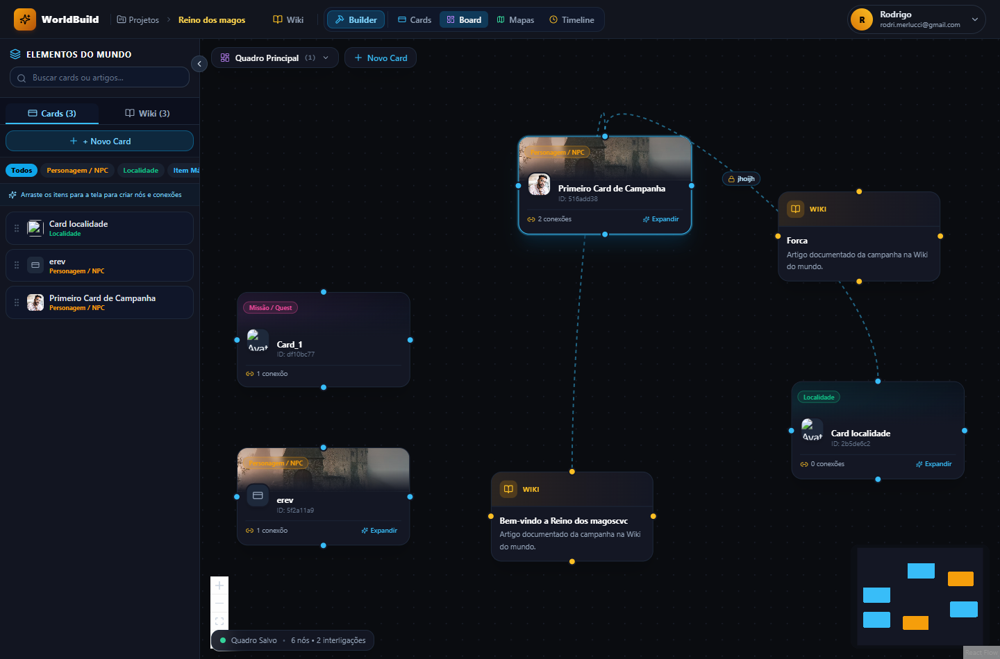

<div align="center">

# 🏰 WorldBuild Hub

**A Plataforma Self-Hosted Definitiva para Criação de Mundos (*Worldbuilding*), Campanhas de RPG & Wikis Visuais**

[](https://nextjs.org/)
[](https://react.dev/)
[](https://www.typescriptlang.org/)
[](https://tailwindcss.com/)
[](https://www.prisma.io/)
[](https://www.docker.com/)
[](LICENSE)

<br />

Inspirado nas melhores funcionalidades do **LegendKeeper** e do **Notion**, o **WorldBuild Hub** combina **Wikis hierárquicas**, **Cards com layout multijanelas (estilo Windows 11)**, **Boards de relacionamentos infinitos (React Flow)**, **Mapas interativos** e **Linha do tempo**, permitindo hospedar seu próprio servidor com **baixo consumo de infraestrutura** (SQLite) ou **alta escala** (PostgreSQL).

[🚀 Instalação Rápida](#-instalação-rápida-self-hosting) •
[✨ Funcionalidades](#-principais-recursos) •
[📖 Wiki Completa](docs/wiki/Home.md) •
[📸 Galeria de Telas](docs/wiki/Galeria-de-Screenshots.md) •
[🏗️ Arquitetura](docs/wiki/Arquitetura-e-Tecnologias.md)

<br />



</div>

---

## ⚡ Instalação Rápida (Self-Hosting)

O WorldBuild Hub inclui um script de instalação interativo que prepara o ambiente, configura o banco de dados desejado e sobe os containers automaticamente.

### 🐧 No Linux / macOS / WSL:
```bash
git clone https://github.com/seu-usuario/worldbuild.git
cd worldbuild
chmod +x install.sh
./install.sh
```

### 🪟 No Windows (PowerShell):
```powershell
git clone https://github.com/seu-usuario/worldbuild.git
cd worldbuild
.\install.ps1
```

O assistente permite escolher entre:
1. **SQLite (Padrão / Recomendado):** Zero overhead de memória, executa em 1 único container com o banco em um único arquivo local. Ideal para Raspberry Pi, VPS básica de 1GB ou uso pessoal.
2. **PostgreSQL:** Container dedicado com alta concorrência para servidores maiores e múltiplos mestres.

---

## 🐳 Executando Diretamente com Docker Compose

Se preferir rodar diretamente sem o instalador:

### Opção 1: SQLite (Ultra-Leve / Zero Infra Extra)
```bash
# Sobe a aplicação diretamente com banco SQLite embutido
docker compose up -d
```

### Opção 2: PostgreSQL (Alta Concorrência)
```bash
# Sobe a aplicação + container do PostgreSQL 16
docker compose --profile postgres up -d
```

* **URL:** [http://localhost:3000](http://localhost:3000)
* **Persistência:** Todos os dados e arquivos enviados são persistidos localmente no diretório `./data/` (`./data/db` e `./data/uploads`).
* **Credenciais Iniciais Pré-configuradas:**
  * **Mestre:** `mestre@worldbuild.com` (Senha: `mestre123`)
  * **Jogador:** `jogador@rpg.com` (Senha: `jogador123`)

---

## ✨ Principais Recursos

### 1. 📖 Wiki de Campanha & Editor TipTap
* Editor de texto rico com suporte completo a atalhos Markdown em tempo real.
* **Menções Inteligentes (`@`):** Conecte cards e artigos digitando `@` no meio do texto.
* **Menu de Ações Flutuante:** Abra menções em nova aba, navegue direto ou abra um **popup modal** de leitura rápida sem sair do contexto atual.
* **Blocos Secretos do Mestre:** Informações confidenciais ocultas para os jogadores.

### 2. 🗂️ Cards de Campanha & Multijanelas (Windows 11)
* **Organização Multitela:** Abra até 4 cartões em simultâneo no mesmo layout (1 card em tela cheia, 2 em colunas divididas, 3 em divisão assimétrica e 4 em grade 2x2).
* **Context Builder:** Crie linhas e colunas de formulários dinâmicos com campos de Texto, Textbox (multilinha até 3 linhas), Imagem/Avatar (com preview limpo), Número, Select/Combobox (Texto, Número ou Referência cruzada) e Checkbox.
* **Templates Reutilizáveis:** Salve modelos prontos por tag e aplique com 1 clique.

| 2 Cards em Colunas | 4 Cards em Grade 2x2 |
| :---: | :---: |
|  |  |

### 3. 📊 Boards de Relacionamentos & Whiteboard
* **Múltiplos Boards:** Crie diversos quadros por projeto (*Quadro Principal*, *Intrigas da Corte*, *Linhagens*).
* **Importação Inteligente com Modal:** Arraste um card da barra lateral para a tela e escolha através de checkboxes se deseja trazer automaticamente as referências conectadas de cards e da wiki.
* **Interligações Automáticas e Protegidas:** Conexões são alimentadas pelo conteúdo real dos cartões com etiqueta da relação e trava de proteção `🔒`.
* **Criação por Arraste:** Puxe uma linha entre dois cards para conectá-los e injetar a menção `@` automaticamente no markdown do card de origem!
* **Criação Rápida:** Crie novos cards diretamente no board e comece a editar imediatamente pela gaveta lateral.

| Conexões e Relações | Criação com Edição Imediata |
| :---: | :---: |
|  |  |

### 4. 🗺️ Mapas Interativos com Pinos
* Mapas regionais com pinos coloridos por categoria e atalhos diretos para os artigos da wiki e cards.

### 5. ⏳ Linha do Tempo (Timeline)
* Sincronização automática entre cards com campos de data marcados e a régua cronológica da campanha.

### 6. 🖼️ Central Universal de Mídias
* Upload unificado com identificador único criptográfico (hash).
* Suporte a `Ctrl + V` para colar imagens diretamente da área de transferência nos formulários e editores.

---

## 🏗️ Estrutura do Monorepo

Gerenciado por **Turborepo** e **pnpm**:

```text
├── apps/
│   ├── web/                     # Aplicação Next.js 15 (App Router + Server Components)
│   ├── mobile/                  # Aplicativo React Native Expo para fichas de RPG
│   └── server/                  # Servidor Fastify WebSocket para sincronização Yjs
├── packages/
│   ├── database/                # Schema Prisma (compatível com SQLite e PostgreSQL)
│   ├── core/                    # Tipos e esquemas de validação Zod
│   ├── editor-engine/           # Extensões e comandos customizados do TipTap
│   └── dnd-rules/               # Cálculos de regras de D&D 5e
├── docs/
│   ├── assets/images/           # 33 capturas de tela e assets visuais
│   └── wiki/                    # Wiki completa para publicação no GitHub
├── data/                        # Diretório persistente local (DB e Uploads)
├── docker-compose.yml           # Configuração de containers Docker
├── install.sh                   # Instalador automático para Linux/macOS
└── install.ps1                  # Instalador automático para Windows
```

---

## 📚 Documentação Completa (GitHub Wiki)

Para guias aprofundados, diagramas e referências técnicas, acesse a pasta [`docs/wiki/`](docs/wiki/) ou a Wiki do repositório:

1. [🏠 Início da Wiki](docs/wiki/Home.md)
2. [🚀 Guia de Instalação e Self-Hosting](docs/wiki/Guia-de-Instalacao-e-Self-Hosting.md)
3. [✨ Manual Detalhado de Funcionalidades](docs/wiki/Funcionalidades.md)
4. [📸 Galeria Completa de Screenshots](docs/wiki/Galeria-de-Screenshots.md)
5. [🏗️ Arquitetura e Tecnologias](docs/wiki/Arquitetura-e-Tecnologias.md)
6. [🗄️ Modelagem de Banco de Dados & DER](docs/wiki/Banco-de-Dados-e-Modelagem.md)
7. [🔌 Referência de APIs](docs/wiki/API-e-Integracoes.md)

---

## 📄 Licença

Distribuído sob a licença MIT. Consulte o arquivo `LICENSE` para obter mais informações.
