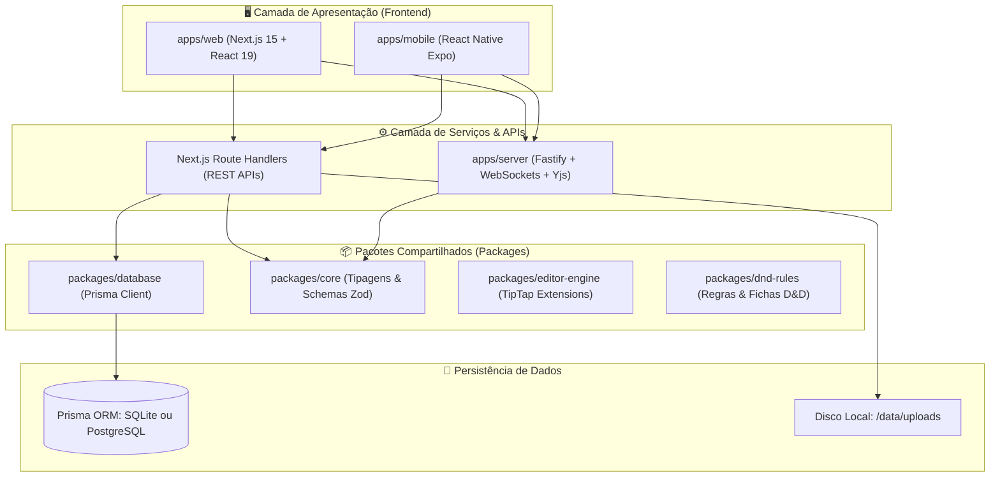

# 🏗️ Arquitetura e Tecnologias

O **WorldBuild Hub** foi projetado seguindo as melhores práticas de desenvolvimento moderno, adotando uma arquitetura **Monorepo** modular gerenciada por **Turborepo** e **pnpm Workspaces**.

---

## 📐 Visão Geral da Arquitetura



---

## 🛠️ Stack Tecnológica

### 1. Frontend & Interface do Usuário
* **Framework:** [Next.js 15](https://nextjs.org/) (utilizando o moderno *App Router* e *React Server Components*).
* **Biblioteca Base:** [React 19](https://react.dev/).
* **Estilização:** [Tailwind CSS](https://tailwindcss.com/) com suporte nativo a temas escuros e glassmorphism.
* **Canvas Interativo & Grafos:** [@xyflow/react (React Flow)](https://reactflow.dev/) para o Whiteboard e Boards de relacionamentos com nós personalizados, física de curvas Bezier e minimapas.
* **Editor de Texto Rico:** [TipTap](https://tiptap.dev/) + [ProseMirror](https://prosemirror.net/) para edição colaborativa e menções `@` interativas.
* **Ícones:** [Lucide React](https://lucide.dev/).

### 2. Camada de Dados & Backend
* **ORM:** [Prisma ORM 6](https://www.prisma.io/) com geração de tipagem estática e suporte dinâmico a SQLite e PostgreSQL.
* **Autenticação:** Sessões seguras com cookies HttpOnly criptografados e controle de acesso baseado em papéis (RBAC).
* **Servidor em Tempo Real (Colaboração CRDT):** [Fastify](https://fastify.dev/) integrado com [Yjs](https://yjs.dev/) e WebSockets para edição concorrente em tempo real.

### 3. Infraestrutura & Containerização
* **Gerenciador de Monorepo:** [Turborepo](https://turbo.build/repo) para caching inteligente de compilação.
* **Gerenciador de Pacotes:** [pnpm](https://pnpm.io/) para economia de espaço em disco e resolução estrita de dependências.
* **Containerização:** Docker com build multi-stage (gerando imagens leves baseadas em Debian Slim / Node 20).
* **Orquestração:** Docker Compose v2 com suporte a perfis (`profiles`).

---

## 📁 Estrutura de Diretórios do Projeto

```text
worldbuild/
├── apps/
│   ├── web/                     # Aplicação Next.js 15 principal
│   │   ├── src/app/             # Rotas do App Router (páginas e APIs REST)
│   │   │   ├── api/             # Endpoints /api/cards, /api/projects, /api/upload...
│   │   │   └── project/         # Telas /wiki, /cards, /board, /maps, /timeline
│   │   └── src/components/      # Componentes UI (cards, whiteboard, layouts)
│   ├── mobile/                  # App móvel Expo para fichas de jogador
│   └── server/                  # Servidor WebSocket Fastify para sync Yjs
│
├── packages/
│   ├── database/                # Schema Prisma, migrações e seed
│   ├── core/                    # Modelos Zod, tipos compartilhados de projetos
│   ├── editor-engine/           # Extensões customizadas do TipTap e menções
│   ├── dnd-rules/               # Cálculos de ficha de RPG (D&D 5e)
│   └── tsconfig/                # Configurações TypeScript base
│
├── docs/                        # Documentação completa e Wiki do GitHub
│   ├── assets/images/           # Capturas de tela e assets visuais
│   └── wiki/                    # Artigos da Wiki em Markdown
│
├── data/                        # Dados persistentes do host (ignorado no git)
│   ├── db/                      # Banco SQLite (dev.db)
│   ├── uploads/                 # Arquivos e imagens carregadas
│   └── postgres/                # Dados do container PostgreSQL
│
├── docker-compose.yml           # Arquivo compose com suporte a SQLite e PostgreSQL
├── Dockerfile                   # Dockerfile multistage de produção
├── docker-entrypoint.sh         # Script de entrada inteligente para inicialização
├── install.sh                   # Instalador automático para Linux/macOS
├── install.ps1                  # Instalador automático para Windows
└── turbo.json                   # Configuração de pipelines do Turborepo
```
