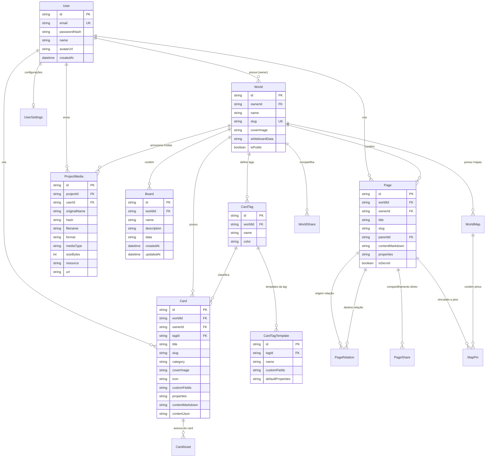

# 🗄️ Modelagem do Banco de Dados & DER

O modelo de dados do **WorldBuild Hub** foi estruturado com o **Prisma ORM**, garantindo integridade referencial, deleções em cascata para evitar dados órfãos e suporte dinâmico tanto a **SQLite** quanto a **PostgreSQL**.

---

## 📊 Diagrama de Entidade-Relacionamento (DER)

---

## 📑 Dicionário das Principais Tabelas

### 1. `World` (Mundos / Projetos)
Representa um universo de RPG ou projeto de criação de mundo.
* `id`: Chave primária única (UUID).
* `ownerId`: Chave estrangeira para o `User` proprietário do mundo.
* `name`: Nome do universo (ex: *Reino de Eldoria*).
* `slug`: Identificador único amigável para URLs.
* `whiteboardData`: Estado serializado legado do quadro, migrado para a tabela `Board`.

### 2. `Board` (Quadros de Relacionamentos)
Armazena a disposição espacial de nós e conexões do Whiteboard do projeto.
* `id`: Chave primária única (UUID).
* `worldId`: Chave estrangeira com deleção em cascata (`onDelete: Cascade`).
* `name`: Nome do quadro (ex: *Quadro Principal*, *Intrigas da Corte*).
* `data`: JSON serializado contendo o array de nós (`nodes`) e arestas (`edges`) do React Flow.

### 3. `Card` (Cartões da Campanha)
Cartões com campos de contexto dinâmicos e conteúdo em markdown.
* `tagId`: Referência opcional à tag do card (`CardTag`).
* `customFields`: Definição JSON dos campos deste card (rótulo, tipo, tamanho).
* `properties`: Valores preenchidos dos campos estruturados (ex: `{"fld_1": "Valefundo"}`).
* `contentMarkdown`: Conteúdo textual principal, incluindo menções TipTap (`data-id`).

### 4. `CardTag` & `CardTagTemplate` (Tags e Templates Dinâmicos)
Permite a customização de categorias por projeto com cores e esquemas salvos.
* `CardTag.color`: Cor hexadecimal associada à tag (ex: `#38bdf8`).
* `CardTagTemplate`: Múltiplos modelos pré-configurados associados a uma mesma tag.

### 5. `Page` & `PageRelation` (Wiki de Campanha)
Documentação hierárquica em árvore de páginas.
* `parentId`: Auto-relacionamento para criação de subpáginas em árvore infinita.
* `isSecret`: Flag que oculta a página para usuários com permissão de jogador.
* `PageRelation`: Conexões semânticas entre páginas (ex: *capital de*, *aliado de*).

### 6. `ProjectMedia` (Gestão Central de Arquivos)
Armazenamento centralizado de mídias enviadas para o projeto.
* `hash`: Identificador criptográfico único do arquivo para evitar conflitos de nomes.
* `resource`: Classificação no formato `[RECURSO]_[FERRAMENTA]` (ex: `banner_card`, `avatar_card`, `pagina_wiki`).
* `url`: Link público de acesso (`/uploads/<hash>.<ext>`).

---

## 🔄 Flexibilidade de Bancos de Dados

O schema Prisma foi desenhado para ser agnóstico quanto ao mecanismo de persistência:
* No **SQLite**, campos do tipo JSON são armazenados como colunas `TEXT` serializadas, consumindo o mínimo de espaço.
* No **PostgreSQL**, o mesmo schema é mapeado com excelente indexação, aproveitando as constraints relacionais e transações ACID.
