# ✨ Funcionalidades do WorldBuild Hub

Este documento detalha todos os recursos, ferramentas e comportamentos da plataforma, acompanhados de ilustrações visuais.

---

## 1. 🏰 Hub de Projetos & Gestão Multi-usuário

O WorldBuild Hub permite gerenciar múltiplos projetos e universos ficcionais em uma única instância.

* **Autenticação Segura:** Login baseado em e-mail e senha criptografada com sessões autenticadas.
* **Projetos Isolados:** Cada universo possui suas próprias configurações, capas, tags, templates e arquivos de mídia.
* **Compartilhamento Granular:** Convide mestres assistentes ou jogadores com papéis específicos (`viewer`, `player`, `editor`).

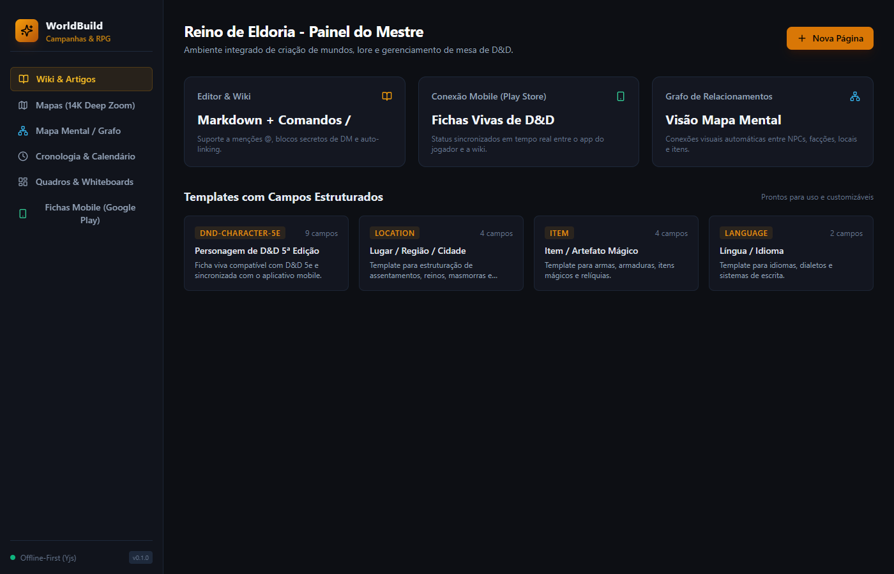

---

## 2. 📖 Wiki de Campanha & Editor Rico

A Wiki de Campanha é o repositório textual do universo, estruturada em árvore de páginas e subpáginas infinitas.

* **Editor Markdown e TipTap:** Formate cabeçalhos (`#`, `##`, `###`), negrito (`**`), itálico (`*`), listas com marcadores (`* ` ou `- `), listas numeradas (`1. `), caixas de seleção / tarefas (`[] `), citações (`> `) e blocos de código (```` ````).
* **Menu de Formatação Flutuante:** Selecionar qualquer trecho de texto abre um menu suspenso para estilização rápida.
* **Menções Dinâmicas (`@`):**
  * Digite `@` para pesquisar em tempo real entre cards e artigos da wiki.
  * O menu exibe as 10 primeiras opções e atualiza dinamicamente conforme você digita.
* **Menu de Ações da Menção:**
  * Clicar em um badge de menção abre um menu de ação:
    1. **Abrir em nova aba:** Não perde o contexto da página atual.
    2. **Abrir em popup modal:** Visualização rápida do conteúdo com leitura limpa sem sair da tela.
    3. **Navegar para a página:** Abre imediatamente o destino.
* **Blocos Secretos do Mestre:** Conteúdo reservado para o mestre que permanece oculto para os jogadores.

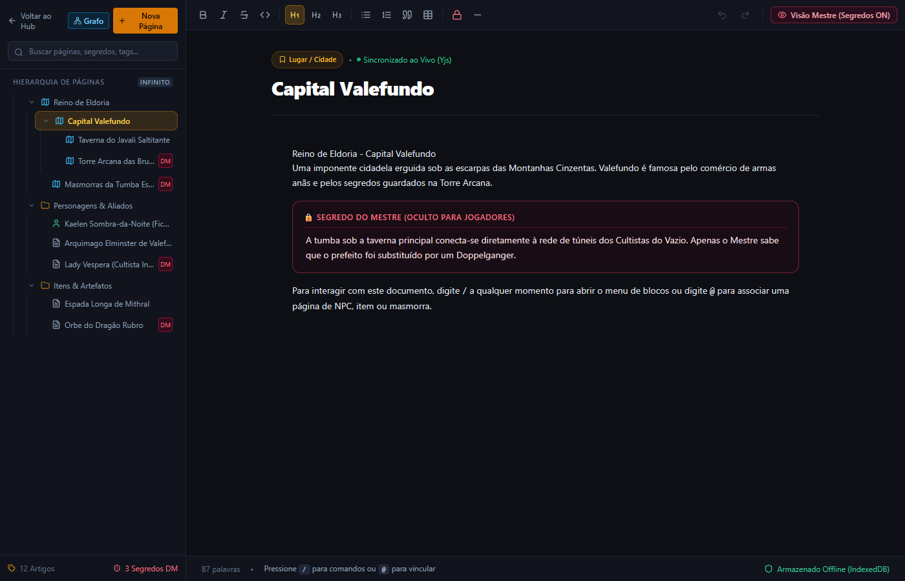

---

## 3. 🗂️ Cards de Campanha & Gestão de Telas (Estilo Windows 11)

Inspirado no gerenciamento de janelas do Windows 11 (*Snap Layouts*), o menu **Cards** permite abrir múltiplos cartões simultaneamente para comparação e consulta ágil durante o jogo.

### Sistema de Grade Multijanelas:
* **1 Card:** Visualização ampla e imersiva em tela cheia.
* **2 Cards:** Divide a tela horizontalmente em 2 colunas proporcionais.
* **3 Cards:** 1 coluna expandida ocupando toda a altura na esquerda e 2 cartões empilhados verticalmente na direita.
* **4 Cards:** Grade 2x2 perfeitamente distribuída.
* **Arrastar e Soltar:** Arraste qualquer card da barra lateral para a área central para adicioná-lo à grade de exibição.

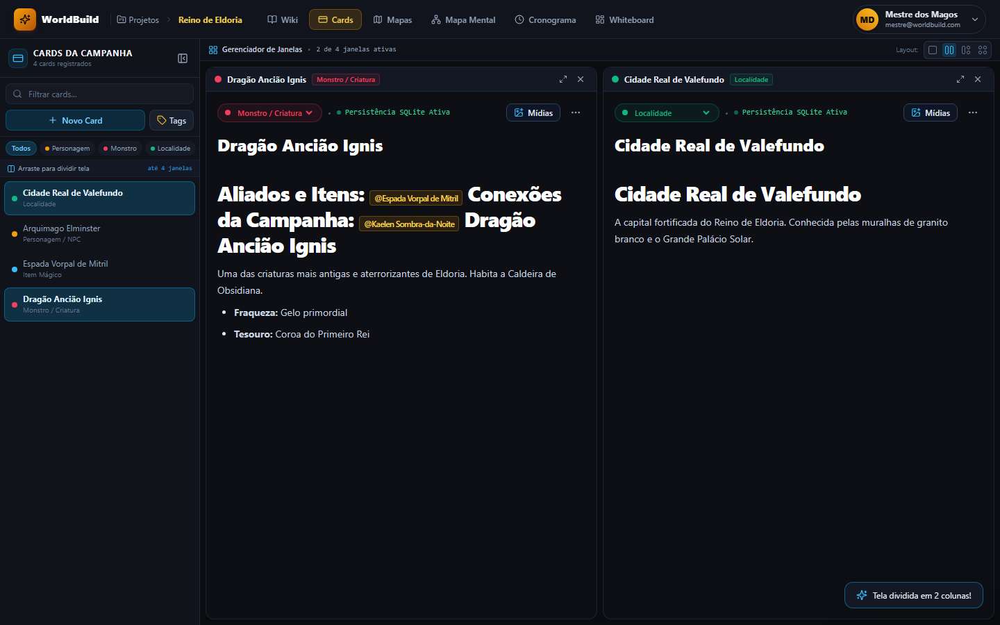
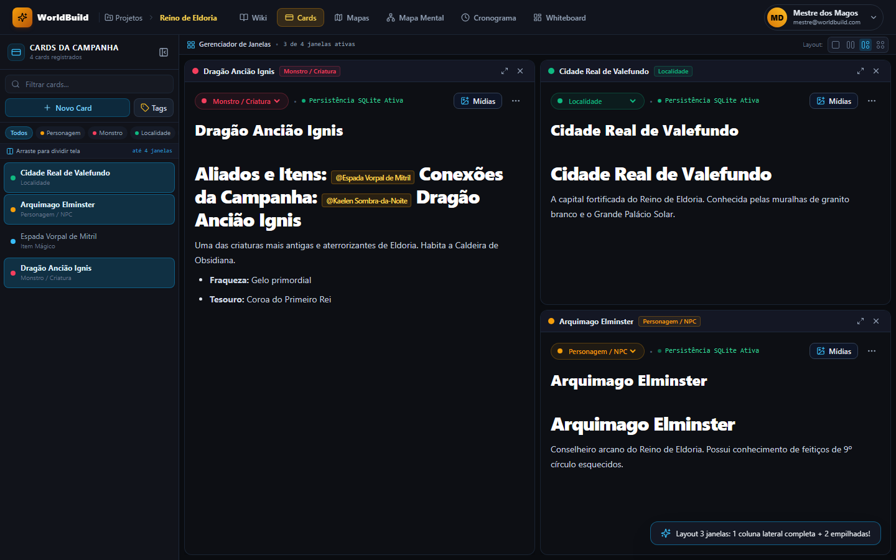
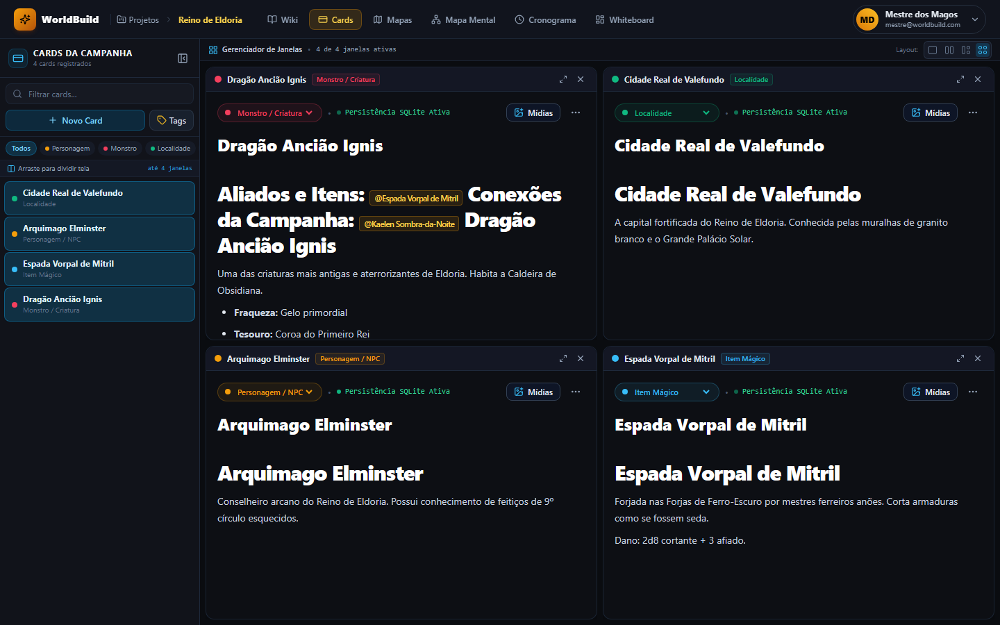

### Tags Customizáveis por Projeto:
* Crie e edite tags personalizadas (ex: *Personagens*, *Localidades*, *Itens Mágicos*, *Facções*).
* Defina cores hexadecimais exclusivas para cada tag, que refletem nos badges dos cards, na wiki e nos nós do board.

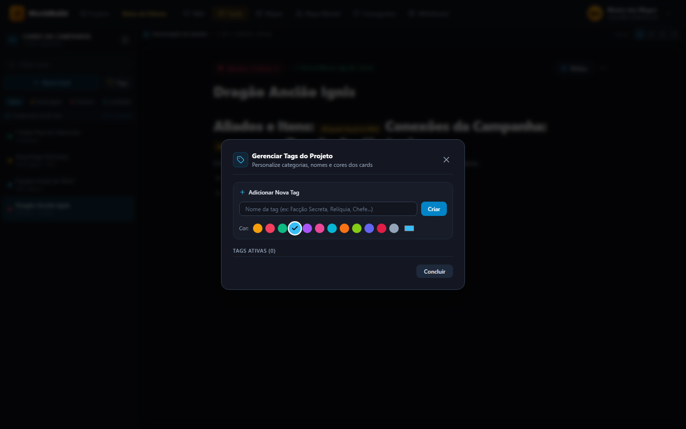

---

## 4. 🧩 Context Builder & Templates Dinâmicos

Cada card possui uma seção superior de **Campos de Contexto** estruturados como formulários antes do markdown livre.

* **Tipos de Campos Suportados:**
  * **Texto Simples:** Nomes, epítetos, títulos curtos.
  * **Textbox Multilinha:** Descrições compactas com expansão vertical em até 3 linhas.
  * **Número:** Idades, população, atributos inteiros ou decimais.
  * **Imagem / Avatar:** Campo limpo de imagem (sem exibir a URL crua) com upload por Ctrl+V e expansão vertical em até 3 linhas.
  * **Select / Combobox:**
    * Opções de Texto
    * Opções Numéricas
    * Referência a outros Cards ou Páginas da Wiki
  * **Checkbox:** Estados booleanos (ex: *Vivo/Morto*, *Aliado/Inimigo*).
  * **Data & Sincronização com a Timeline:** Permite registrar datas históricas (dia/mês/ano ou apenas ano) e marcar o checkbox de envio automático para a Linha do Tempo.
* **Templates por Tag:**
  * Salve combinações de campos como templates reutilizáveis (ex: Template *Cidade Completa*, Template *Ficha NPC*).
  * Aplique templates existentes ou crie cartões sem tag obrigatória.

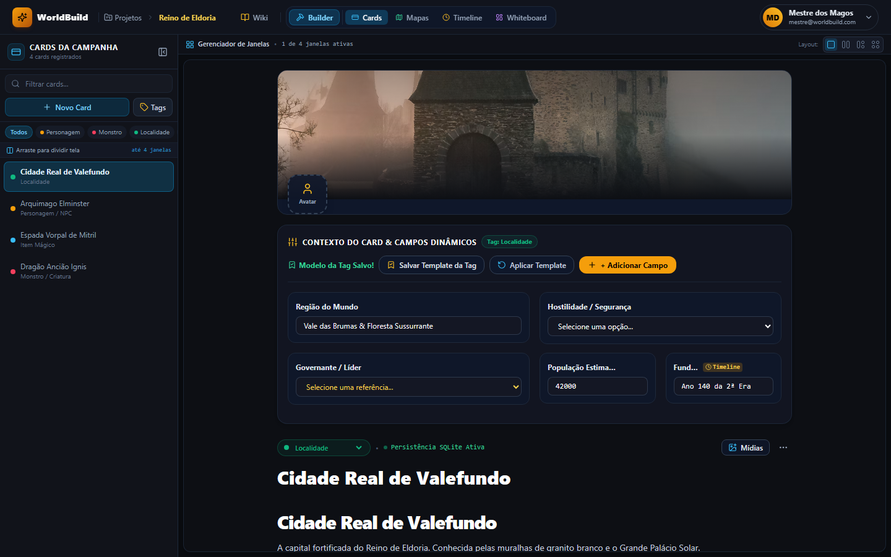
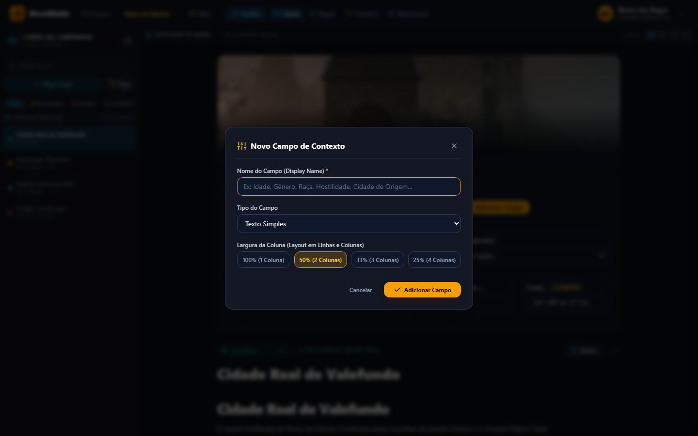

---

## 5. 📊 Boards de Relacionamentos & Whiteboard

O **Board** oferece uma tela infinita baseada no **React Flow** para mapear visualmente todas as conexões do mundo.

### Múltiplos Boards por Projeto:
* Crie diversos quadros temáticos (ex: *Quadro Principal*, *Conspirações Políticas*, *Árvore Familiar*).
* Alterne entre eles instantaneamente pelo seletor no topo da tela com auto-save integrado.

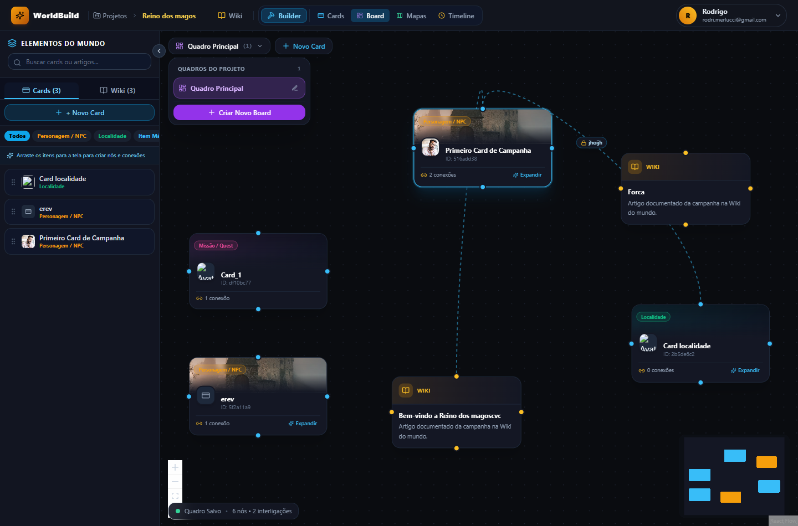
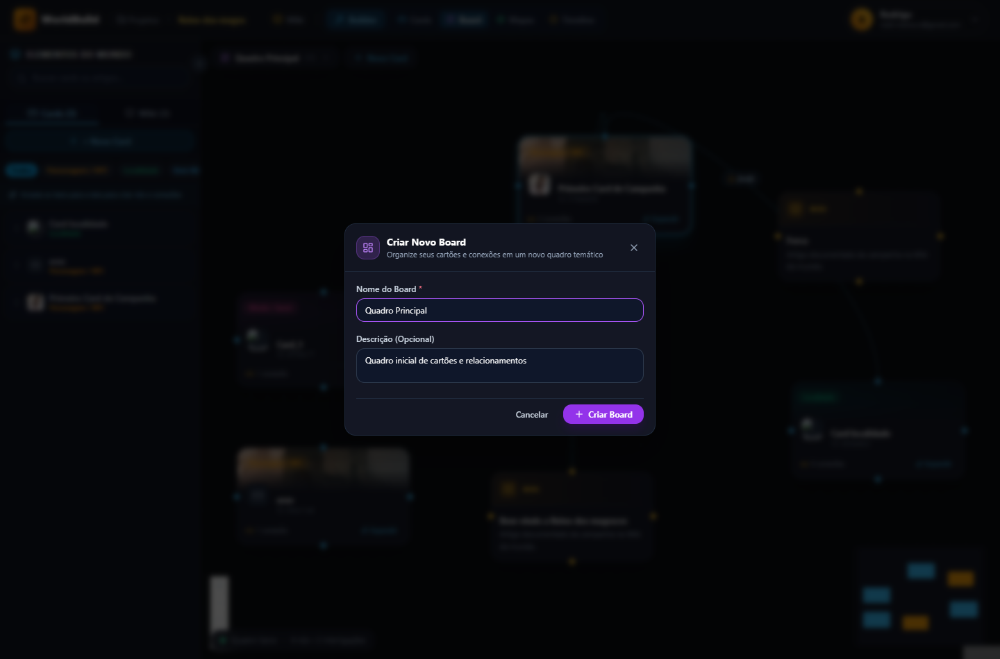

### Importação de Referências com Popup Modal:
* Ao arrastar um card da barra lateral para o canvas, o sistema detecta todas as menções e referências existentes.
* Um popup modal permite selecionar via checkboxes se deseja trazer referências de **Cards vinculados** e/ou **Páginas da Wiki**.
* Ao confirmar, os nós são posicionados radialmente ao redor do card principal com as conexões traçadas automaticamente.

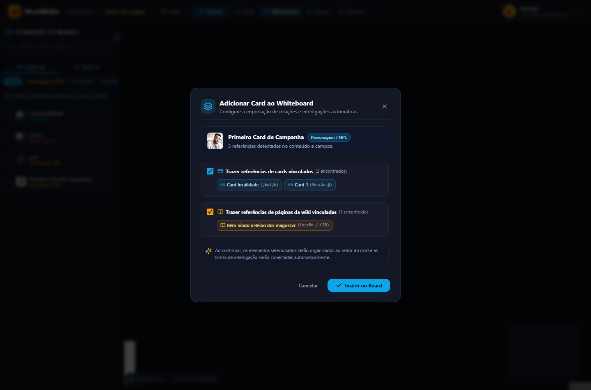
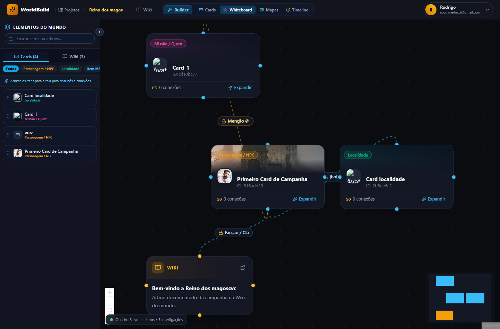

### Interligações Automáticas e Protegidas:
* Conexões baseadas em conteúdo exibem o rótulo do campo ou menção e o ícone `🔒`.
* Não podem ser deletadas diretamente no quadro: o sistema avisa que a interligação é gerada pelo conteúdo e só pode ser removida editando o card correspondente.
* Se um relacionamento for criado ou removido dentro de um card, o board sincroniza automaticamente.

### Criação de Relacionamentos por Arraste:
* Puxe uma linha entre um **Card A** e um **Card B** no board:
  * O sistema registra a conexão e adiciona automaticamente no final do markdown do Card A a menção `@Card B`.
  * A aresta vira uma interligação protegida permanente.

### Criação Rápida de Card pelo Board:
* Clique no botão **+ Novo Card** no topo ou na barra lateral:
  * O card é criado no banco de dados e adicionado ao centro do board.
  * A gaveta lateral direita abre imediatamente para você editar o título, campos e conteúdo sem trocar de tela.

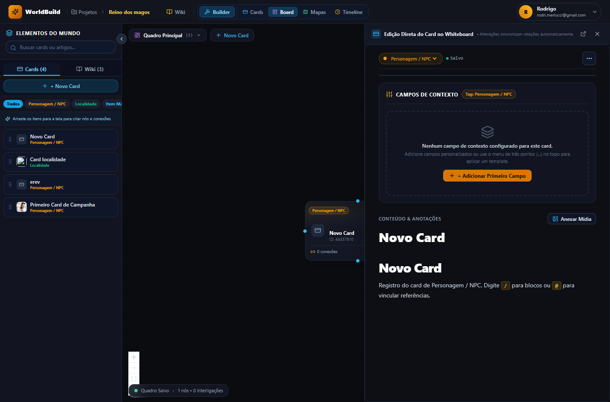

---

## 6. 🗺️ Mapas Interativos com Pinos

* Envie imagens de alta resolução de continentes, reinos, cidades ou masmorras.
* Posicione pinos interativos coloridos por categoria (capitais, fortalezas, ruínas).
* Clique no pino para abrir diretamente o artigo correspondente na wiki ou o card da campanha.

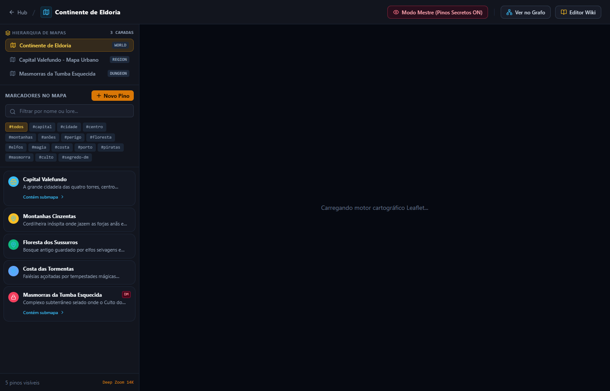

---

## 7. ⏳ Linha do Tempo (Timeline)

* Visualize a cronologia de acontecimentos do seu universo em ordem linear ou por eras.
* Qualquer card que contenha um campo de data vinculado à timeline é automaticamente sincronizado com a régua cronológica.

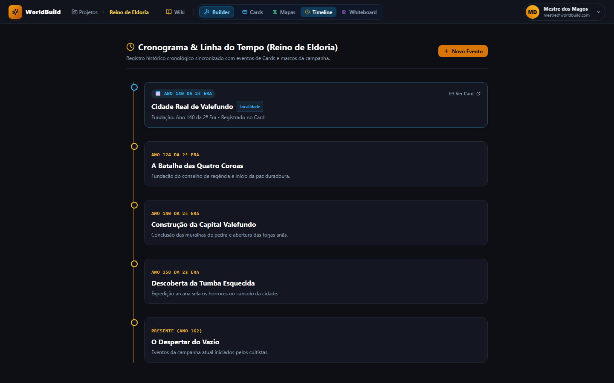

---

## 8. 🖼️ Gestão Universal de Mídias

* **Padrão Unificado:** Toda imagem ou mídia enviada é processada por um endpoint único, recebendo uma hash única para evitar conflitos de nomes.
* **Rastreabilidade:** Cada mídia é catalogada no banco de dados com tamanho, formato, usuário e recurso (`[RECURSO]_[FERRAMENTA]`).
* **Suporte a Ctrl+V:** Cole imagens diretamente da área de transferência nos editores e formulários.
