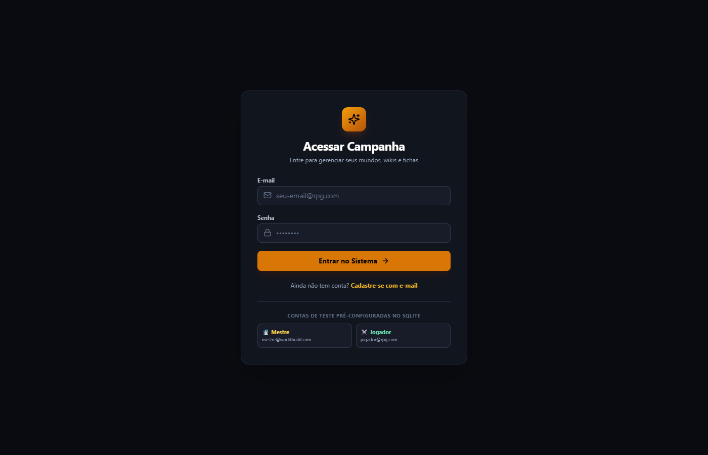
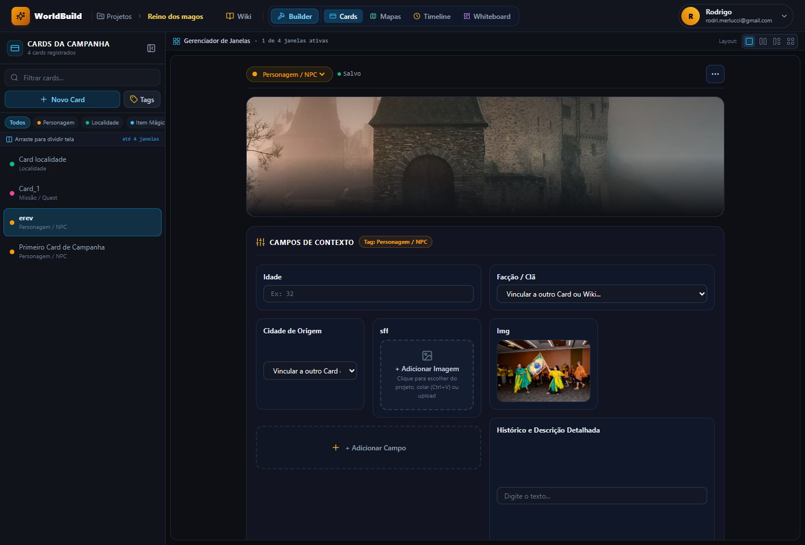
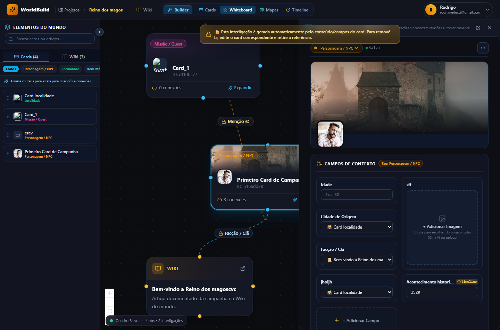

# 📸 Galeria de Screenshots & Demonstração Visual

Explore os principais módulos e telas do **WorldBuild Hub**.

---

## 🏰 1. Hub de Projetos & Acesso

| Tela Inicial do Hub | Tela de Autenticação |
| :---: | :---: |
|  |  |
| *Listagem de universos, capas e membros* | *Login seguro multi-usuário* |

---

## 📖 2. Wiki de Campanha & Editor Rico

*Navegação hierárquica em árvore de artigos, editor TipTap, formatação rápida e blocos secretos do Mestre.*

---

## 🗂️ 3. Cards de Campanha & Multijanelas (Estilo Windows 11)

| 2 Cards em Colunas Divididas | 3 Cards em Divisão Assimétrica |
| :---: | :---: |
|  |  |
| *Comparação direta de dois cartões* | *Coluna principal e 2 cartões empilhados* |

| Grade 2x2 com 4 Cards | Gestão de Tags Customizadas do Projeto |
| :---: | :---: |
|  |  |
| *Exibição simultânea de 4 cartões em grade* | *Criação de tags com cores personalizadas* |

---

## 🧩 4. Context Builder & Formulários Dinâmicos

| Context Builder com Banner e Avatar | Modal de Adição de Novos Campos |
| :---: | :---: |
|  |  |
| *Linhas e colunas de formulários no topo do card* | *Campos de texto, número, referência, etc.* |

| Imagens e Textboxes Expandidas em 2 ou 3 Linhas | Campos com Sincronização de Timeline |
| :---: | :---: |
|  |  |
| *Imagens sem exibir URLs cruas e textboxes multilinhas* | *Datas com envio automático para o cronograma* |

---

## 📊 5. Boards de Relacionamentos & Whiteboard

| Visão Geral do Board e Seletor | Menu Suspenso de Quadros |
| :---: | :---: |
|  |  |
| *Tela infinita com nós interligados e minimap* | *Gestão de múltiplos quadros por projeto* |

| Modal de Criação de Novo Board | Modal de Importação de Referências |
| :---: | :---: |
|  |  |
| *Criação de quadros temáticos dedicados* | *Seleção inteligente de referências de cards e wiki* |

| Interligações Automáticas e Protegidas | Criação de Card com Edição Lateral Imediata |
| :---: | :---: |
|  |  |
| *Conexões com tags de campo e ícone de bloqueio 🔒* | *Criação rápida com gaveta lateral aberta para preenchimento* |

| Edição Direta do Card na Gaveta Lateral do Board |
| :---: |
|  |
| *Modificações no card sincronizam em tempo real com as conexões do quadro* |

---

## 🗺️ 6. Mapas Interativos com Marcadores

*Mapas regionais com pinos coloridos por categoria e atalhos rápidos para a wiki e cards.*
