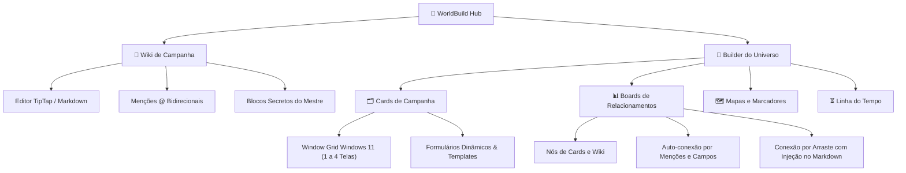

# 🏰 WorldBuild Hub - Documentação & Wiki Oficial

Bem-vindo à Wiki oficial do **WorldBuild Hub**, uma plataforma self-hosted completa para criação de universos ficcionais (*worldbuilding*), documentação de campanhas de RPG de mesa e organização visual com mapas, cartões de contexto e quadros de relacionamentos.

Inspirado em ferramentas como o **LegendKeeper**, o WorldBuild Hub foi desenhado desde a sua base para oferecer máxima flexibilidade, controle total de dados pelo usuário através de auto-hospedagem (*self-hosting*) e excelente performance com baixo consumo de infraestrutura.

---

## 🎯 Pilares da Plataforma



---

## 🌟 Principais Recursos

### 1. 📖 Wiki de Campanha
* **Editor em Tempo Real:** Suporte completo a atalhos de Markdown (títulos, negrito, itálico, código, listas, citações).
* **Menções Inteligentes (`@`):** Conecte qualquer página da wiki ou card de campanha digitando `@` no meio do texto.
* **Menu de Ação Suspenso:** Ao clicar em uma menção, abra a página em nova aba, abra na tela atual ou visualize instantaneamente em um popup modal.
* **Visão Secreta do Mestre:** Blocos de anotações visíveis apenas para o mestre da mesa.

### 2. 🗂️ Cards de Campanha & Layout Windows 11
* **Multijanelas Dinâmicas:** Abra até 4 cards simultaneamente em grade (1 card em tela cheia, 2 cards em colunas divididas, 3 cards em divisão assimétrica e 4 cards em grade 2x2).
* **Context Builder:** Crie linhas e colunas de formulários personalizáveis: campos de texto, números, referências cruzadas, checkboxes, comboboxes, imagens expandidas em até 3 linhas e caixas de texto com autosize.
* **Templates Reutilizáveis:** Defina esquemas visuais para categorias (ex: *Cidades*, *Personagens*, *Monstros*, *Missões*) e aplique aos novos cartões com 1 clique.

### 3. 📊 Boards de Relacionamentos
* **Quadros Infinitos:** Organize seus cartões e artigos da wiki visualmente com pan e zoom suave através do **React Flow**.
* **Múltiplos Boards:** Crie diversos quadros por projeto (ex: *Quadro Principal*, *Relações Políticas*, *Árvore Genealógica*).
* **Interligações Automáticas e Protegidas:** As arestas entre os nós são mantidas e sincronizadas pelo conteúdo real dos cards.
* **Criação por Arraste:** Puxe uma linha entre dois cards no board para criar uma relação e injetar automaticamente a menção `@` no texto do card de origem.
* **Criação Rápida:** Crie novos cards diretamente no board e comece a editar imediatamente pela gaveta lateral.

### 4. 🗺️ Mapas Interativos
* **Pinos & Marcadores:** Adicione marcadores coloridos por categoria vinculados aos artigos da wiki e aos cards do mundo.
* **Zoom Suave:** Navegação rápida e clara sobre mapas regionais ou globais.

### 5. ⏳ Linha do Tempo (Timeline)
* **Sincronização Nativa:** Cards com campos de data marcados como "Vincular à Timeline" aparecem automaticamente na ordem cronológica correta dos acontecimentos históricos.

### 6. 🖼️ Central Universal de Mídias
* **Uploads em 1 Clique:** Suporte nativo a `Ctrl + V` para colar imagens diretamente no editor ou envio por seleção de arquivos.
* **Identificador Único por Hash:** Evita duplicidade de arquivos e rastreia o recurso de origem (`[RECURSO]_[FERRAMENTA]`).

---

## 🚀 Como Começar (Self-Hosting)

O WorldBuild Hub foi projetado para rodar em qualquer máquina com **Docker**:

```bash
# Clone o repositório
git clone https://github.com/seu-usuario/worldbuild.git
cd worldbuild

# Execute o instalador automático:
# No Linux/macOS:
chmod +x install.sh && ./install.sh

# No Windows PowerShell:
.\install.ps1
```

O instalador permite escolher entre:
* **SQLite (Padrão):** Ideal para servidores pessoais, Raspberry Pi ou VPS pequenas (zero consumo extra de memória RAM, banco armazenado em um único arquivo).
* **PostgreSQL:** Recomendado para ambientes com muitos usuários simultâneos e grande volume de transações.

---

## 📚 Índice da Documentação

1. [🚀 Guia de Instalação e Self-Hosting](Guia-de-Instalacao-e-Self-Hosting)
2. [✨ Manual Completo de Funcionalidades](Funcionalidades)
3. [📸 Galeria Visual de Screenshots](Galeria-de-Screenshots)
4. [🏗️ Arquitetura e Tecnologias](Arquitetura-e-Tecnologias)
5. [🗄️ Modelagem do Banco de Dados & DER](Banco-de-Dados-e-Modelagem)
6. [🔌 Referência de Endpoints da API](API-e-Integracoes)
